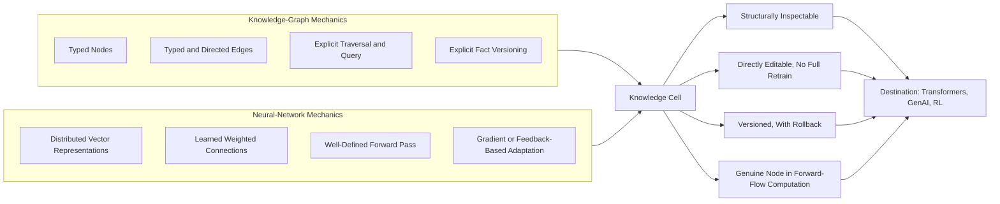
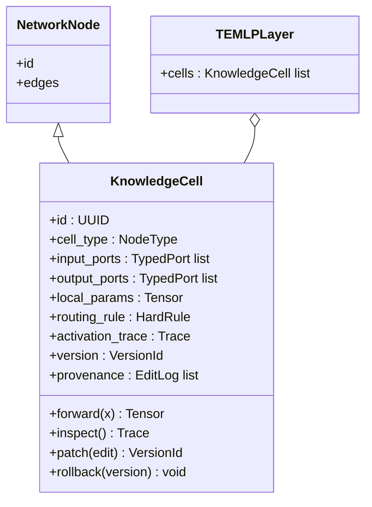
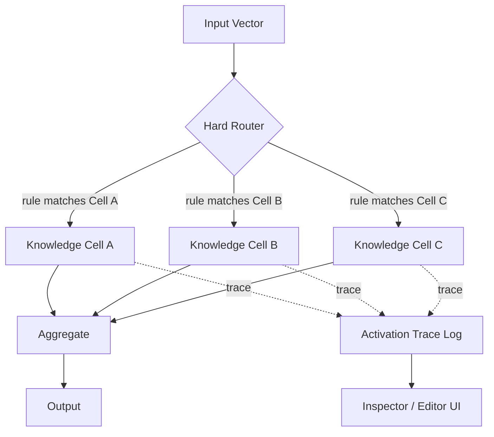
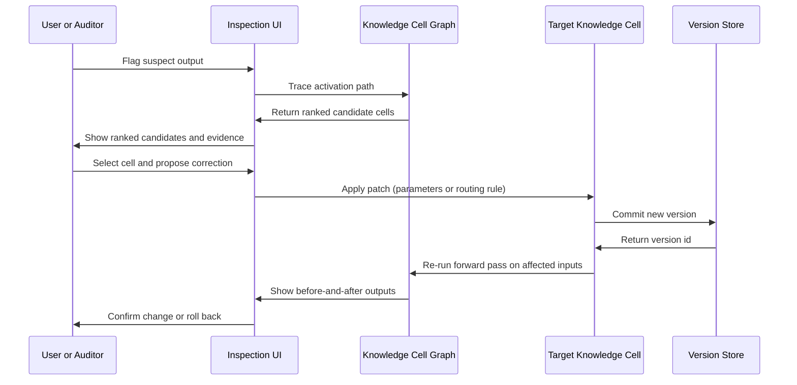
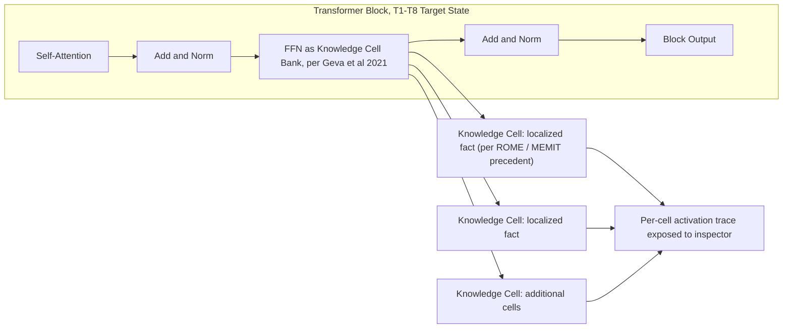
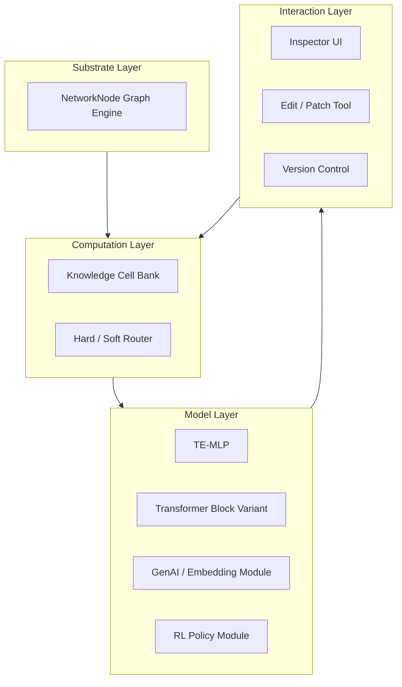
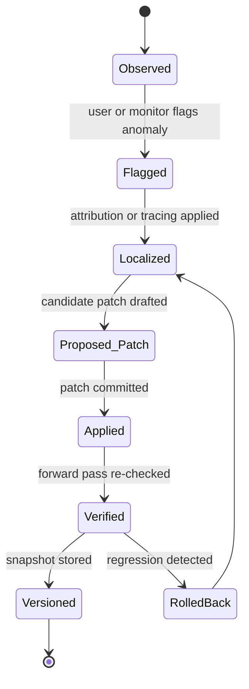
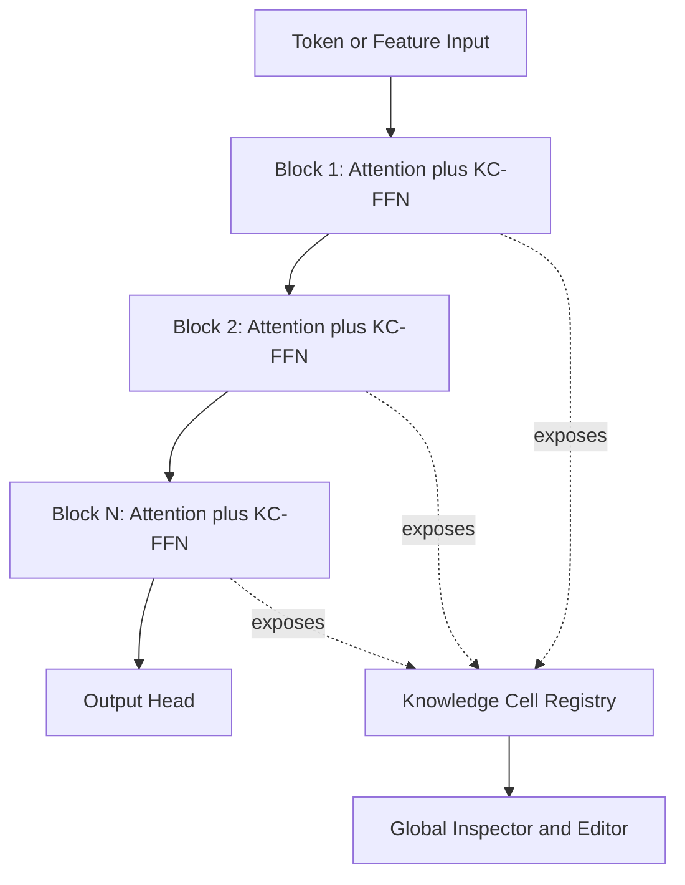
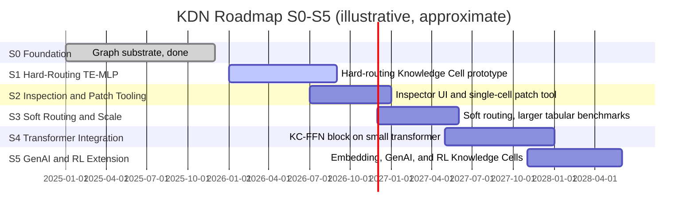

# Transparent Editable Neural Substrates

**Combining Knowledge-Graph Mechanics with Neural Forward Flow -- Literature Survey, Theory, and Architecture Roadmap for Transformers, GenAI, and Reinforcement Learning**

- Author: Arin Bansal
- Date: 2 August 2026
- Project: FIGPSO UIL / KDN

---

## 0. How to Read This Document

Every substantive claim in this document is tagged, implicitly or explicitly, with one of three evidence levels. Readers should interpret each section through this lens rather than assuming uniform certainty across the whole document.

- **Observed** -- something that has actually been measured or run, either inside the current UIL proof-of-concept codebase, or reported as an experimental result inside one of the cited papers. Observed claims are the strongest kind of evidence in this document, but they are also the narrowest in scope: an observed result about the NetworkNode graph substrate does not automatically transfer to transformers, GenAI, or RL.
- **Designed** -- something that has a concrete specification, data structure, or partial implementation in the current codebase or architecture documents, but has not yet been stress-tested at scale, under adversarial conditions, or across the full range of intended use cases. Designed claims describe intent and partial construction, not proof.
- **Proposed** -- a forward-looking architectural or research claim that is presented here as a roadmap item or hypothesis, not as a completed result. Proposed claims are the least certain and are explicitly marked as such wherever they appear, particularly in Sections 6, 7, and 8.

Throughout the survey (Section 3) and the theory sections (Sections 5 to 8), phrases like "we have observed," "the PoC demonstrates," or "tested" indicate Observed evidence; phrases like "is designed to," "the schema specifies," or "the current prototype" indicate Designed status; and phrases like "would need to," "the roadmap calls for," or "a future version should" indicate Proposed status. Section 9 (Non-Claims) exists specifically to prevent Designed or Proposed material from being mistaken for Observed results.

---

## 1. Scientific Thesis

The central thesis of this project is that knowledge-graph (KG) mechanics and neural-network (NN) mechanics are not competing paradigms for building intelligent systems, but complementary halves of a single substrate. KG mechanics contribute typed nodes, typed and directed edges, explicit traversal, and explicit versioning of facts -- properties that make a system structurally legible to a human reader. NN mechanics contribute distributed vector representations, learned weighted connections, a differentiable (or at minimum, a well-defined) forward pass, and gradient-based or feedback-based adaptation -- properties that make a system capable of learning from data rather than only encoding hand-authored rules.

The thesis is that combining these two mechanics inside a single computational unit -- here called a **Knowledge Cell** -- produces a substrate that is simultaneously:

1. **Structurally inspectable**, in the same sense that a KG node with typed edges is inspectable: a human can ask "what is this unit, what does it connect to, and what does it currently believe" and get a direct answer.
2. **Directly editable**, meaning a specific, localized correction can be made to a specific cell without retraining the entire model from scratch, in the spirit of localized model-editing methods such as ROME (Meng et al., 2022) and MEMIT (Meng et al., 2023), but generalized as a first-class property of the substrate rather than a post-hoc surgical patch applied to an otherwise opaque network.
3. **Versioned**, so that every correction has provenance: who or what changed the cell, when, and what the prior state was, with the ability to roll back.
4. **A genuine participant in forward-flow computation**, meaning the Knowledge Cell is not merely a symbolic lookup table sitting beside a neural network (as in many neural-symbolic integration patterns surveyed by Besold et al., 2017), but an actual node in the live computational graph that receives input, produces output, and can be composed with other cells into deeper structures, including eventually transformer blocks, generative pipelines, and reinforcement learning policies.

The current Unified Intelligence Layer (UIL) proof-of-concept exists to establish the smallest possible version of this claim: that in a tabular AutoML setting, individual computational nodes (NetworkNode instances) can be inspected, that errors or outdated knowledge inside them can be identified, and that they can be corrected in real time, with the correction taking effect in the live forward pass rather than requiring a full retrain. The PoC does **not** attempt to prove that this approach produces better raw predictive accuracy than a tuned MLP or a foundation model such as TabPFN (Hollmann et al., 2023); accuracy is deliberately not the claim being tested (see Section 2 and Section 9).

The destination implied by this thesis is not a better tabular classifier. It is an architectural pattern -- the Knowledge Cell and its container, the Knowledge-Directed Network (KDN) -- that, if it holds up as it scales, could eventually be applied inside transformer feed-forward sublayers, generative and embedding pipelines, and reinforcement learning policies, in each case making a currently opaque region of the model into something a human can inspect, attribute, correct, and version. Sections 6 through 8 describe, honestly and with Proposed-level confidence, what changes would be required to move toward that destination.

---

## 2. Current UIL Proof-of-Concept: Honest Status

The table below states, without exaggeration, what exists today.

| Component | Transparency Level | Neural Basis | Status | Notes |
|---|---|---|---|---|
| NetworkNode (graph substrate) | High | Low to none (symbolic/graph-native) | Built and tested | Typed nodes, typed edges, traversal, and per-node inspection and correction are implemented and have been exercised in the PoC. |
| TE-MLP / Knowledge Cell bridging layer | Medium | Medium (hybrid: hard-routed gating over hidden units) | Designed, partially prototyped | Forward flow through discrete Knowledge Cells is specified; a full training-loop stress test at scale has not yet been completed. |
| MLP baseline | Low | High (fully distributed, dense) | Built and tested (baseline only) | Standard dense layers used strictly as an accuracy comparison point, not as part of the transparency contribution. |
| TabPFN comparison | Low | High (fully distributed, in-context transformer) | Built and tested (external baseline) | Used only as an external tabular-accuracy reference point (Hollmann et al., 2023); not part of the transparency claim. |
| KDN (Knowledge-Directed Network), full pipeline | Not yet applicable | Not yet applicable | Designed, not fully built | This document specifies the target architecture; end-to-end implementation is tracked as roadmap items S1 through S5 in Section 8. |

**The central honest statement of this project:** tabular prediction accuracy is not the scientific win being claimed here. NetworkNode, the MLP baseline, and TabPFN all sit on a spectrum from high to low transparency, and the higher-transparency end of that spectrum (NetworkNode) is not being claimed as the more accurate one. The claim under test is narrower and, if true, more structurally significant: that individual computational nodes in this substrate can be inspected, that the source of a specific error or piece of outdated knowledge inside a node can be attributed, and that a correction can be applied directly to that node and take effect in the live forward pass, without a full retrain. KDN, the architecture intended to generalize this property beyond the current PoC, is designed in this document but is not yet fully built.

---

## 3. Literature Survey

Twenty-two papers are surveyed below. Each entry lists the citation exactly as verified, followed by a short summary, its relevance to the Knowledge Cell / KDN thesis, and an honest limit relative to that thesis. No paper below is invented; all citations were supplied and verified prior to writing this survey.

### P1. Kolmogorov-Arnold Networks (KAN)
- Citation: Liu et al., 2024. "KAN: Kolmogorov-Arnold Networks." arXiv:2404.19756.
- Summary: Proposes replacing the fixed nonlinear activation functions that normally sit on the nodes of a multilayer perceptron with learnable univariate spline functions placed on the edges instead, motivated by the Kolmogorov-Arnold representation theorem. The authors report competitive or improved accuracy on selected tasks alongside claims of improved interpretability, since each edge carries an inspectable one-dimensional function.
- Relevance: KAN is the closest existing precedent for structural legibility inside a differentiable network: instead of a wall of dense weights, each connection is an inspectable object. This is directly analogous to giving a Knowledge Cell edge a typed, inspectable identity.
- Limit: KAN interpretability applies to individual edge functions, not to a versioned, editable, graph-native node with typed ports and provenance. KAN does not address editability, versioning, or knowledge-graph-style traversal.

### P2. Concept Bottleneck Models (CBM)
- Citation: Koh et al., 2020. "Concept Bottleneck Models." ICML. arXiv:2007.04612.
- Summary: Inserts an explicit bottleneck layer of human-specified, human-interpretable concepts between the raw input and the final prediction layer. Because the bottleneck is human-legible, a user can intervene at test time by directly editing a concept value and observe the effect propagate to the final prediction.
- Relevance: CBM is one of the strongest existing precedents for test-time human intervention on an intermediate representation, which is close in spirit to editing a Knowledge Cell and observing the corrected forward pass.
- Limit: The bottleneck concepts in CBM must be hand-specified in advance and are typically a single global layer, not a distributed, versioned, graph-structured set of many small inspectable cells with provenance tracking.

### P3. Neural-Symbolic Learning and Reasoning Survey
- Citation: Besold et al., 2017. "Neural-Symbolic Learning and Reasoning: A Survey and Interpretation." arXiv:1711.03902.
- Summary: A broad survey and taxonomy of methods that integrate neural network learning with symbolic or logic-based reasoning, covering knowledge extraction, knowledge insertion, and hybrid reasoning architectures across several decades of prior work.
- Relevance: Establishes the intellectual lineage that this project sits inside, and provides a taxonomy against which the Knowledge Cell approach can be positioned (it is closest to what the survey calls tightly integrated hybrid systems, rather than loosely coupled pipelines).
- Limit: As a 2017 survey, it necessarily predates the transformer-era editing and mechanistic-interpretability literature (P7 through P14, P22 below) and does not anticipate localized weight-editing methods such as ROME or MEMIT.

### P4. RuleFit
- Citation: Friedman and Popescu, 2008. "Predictive Learning via Rule Ensembles." Annals of Applied Statistics.
- Summary: Combines a large ensemble of simple decision rules, extracted from tree ensembles, with a sparse linear model fit over those rules (plus the original features), producing an additive, rule-based model that is more interpretable than the tree ensemble it was derived from while retaining much of its predictive accuracy.
- Relevance: RuleFit is an early, well-validated precedent for the specific design choice this project favors early on: hard, discrete routing rules (Section 5) that are individually inspectable, rather than a fully soft, distributed representation from the start.
- Limit: RuleFit rules are extracted post hoc from tree ensembles rather than being first-class, versioned, editable units inside a live forward-flow computation graph.

### P5. Graph Convolutional Networks (GCN)
- Citation: Kipf and Welling, 2017. "Semi-Supervised Classification with Graph Convolutional Networks." ICLR. arXiv:1609.02907.
- Summary: Introduces a layer-wise propagation rule that approximates spectral graph convolutions, enabling a neural network to learn directly over graph-structured data by aggregating neighbor features at each layer, and demonstrates strong performance on semi-supervised node classification.
- Relevance: GCN is a foundational precedent for a neural network whose computation is explicitly organized around a graph topology, which is a prerequisite building block for treating a Knowledge Cell graph as something a neural forward pass can actually traverse and aggregate over.
- Limit: GCN node representations are still fully distributed, dense vectors; a GCN node is not individually inspectable, editable, or versioned in the sense required by this thesis.

### P6. TransE
- Citation: Bordes et al., 2013. "Translating Embeddings for Modeling Multi-Relational Data." NeurIPS.
- Summary: Embeds knowledge-graph entities and relations into a shared vector space such that a relation behaves approximately as a translation vector between a head entity embedding and a tail entity embedding (head plus relation approximately equals tail). This simple, scalable formulation became foundational for knowledge-graph embedding research.
- Relevance: TransE is the canonical example of representing typed KG relations as operations inside a vector space, which is exactly the kind of KG-mechanics-meets-vector-mechanics pattern that a Knowledge Cell needs at the edge level.
- Limit: TransE embeddings are global and dense; there is no notion of a single, correctable, versioned cell, and no forward-flow computation beyond the translation scoring function itself.

### P7. Transformer Feed-Forward Layers Are Key-Value Memories
- Citation: Geva et al., 2021. "Transformer Feed-Forward Layers Are Key-Value Memories." EMNLP. arXiv:2012.14913.
- Summary: Shows empirically that the feed-forward (FFN) sublayers of a transformer operate similarly to key-value memories: each first-layer weight vector (key) responds to specific, often human-describable input patterns, and the corresponding second-layer weight vector (value) contributes an interpretable, additive push to the output vocabulary distribution.
- Relevance: This paper is the single strongest existing precedent for the claim that transformer FFN sublayers already contain something resembling many small, semi-inspectable memory cells. It is the direct empirical basis for treating FFN sublayers as a natural place to introduce explicit Knowledge Cells (see Section 6, items T1 and T7).
- Limit: The key-value structure described is discovered post hoc via analysis, not designed in as a first-class, versioned, user-editable structure. There is no user-facing editing or rollback mechanism in this work.

### P8. ROME (Rank-One Model Editing)
- Citation: Meng et al., 2022. "Locating and Editing Factual Associations in GPT." NeurIPS. arXiv:2202.05262.
- Summary: Uses a causal-tracing procedure to localize a specific factual association to a small number of mid-layer FFN modules inside a GPT-style transformer, then applies a targeted rank-one update to the relevant weight matrix to change that single fact, while showing that most other model behavior is left largely intact.
- Relevance: ROME is the strongest existing precedent for the core editability claim of this project: that a single, localized correction can be applied directly to a specific part of a trained network, without a full retrain, and that the effect is largely confined to the targeted fact.
- Limit: ROME edits are found and applied by researchers using causal tracing tools external to the model; there is no persistent, user-facing, versioned Knowledge Cell abstraction, and ROME edits are known (per later work, including P9 and P22) to degrade in reliability as more edits are applied.

### P9. MEMIT (Mass-Editing Memory in a Transformer)
- Citation: Meng et al., 2023. "Mass-Editing Memory in a Transformer." ICLR. arXiv:2210.07229.
- Summary: Extends the rank-one editing approach of ROME to allow thousands of factual edits to be applied simultaneously, by distributing the required weight updates across a range of transformer layers rather than concentrating them in a single layer.
- Relevance: MEMIT demonstrates that localized editing can scale to many simultaneous corrections, which is directly relevant to a Knowledge Cell substrate that expects many cells to be correctable over the lifetime of a deployed model (see roadmap item T4 in Section 6).
- Limit: Like ROME, MEMIT edits are applied through an external algorithmic procedure rather than through a persistent, inspectable, versioned cell abstraction; there is no built-in rollback or provenance log.

### P10. Knowledge Neurons
- Citation: Dai et al., 2022. "Knowledge Neurons in Pretrained Transformers." ACL. arXiv:2104.08696.
- Summary: Proposes an attribution method to identify specific neurons inside transformer FFN layers that are responsible for expressing a particular piece of factual knowledge, and shows that suppressing or amplifying the activations of these "knowledge neurons" can suppress, amplify, or edit the expression of the corresponding fact.
- Relevance: This is a direct precedent for the idea that individual neurons or small neuron groups can be attributed to specific pieces of knowledge and then directly manipulated, which is close in spirit to correcting a single Knowledge Cell.
- Limit: The attribution and editing procedure operates on raw neuron activations inside an otherwise standard, unmodified transformer; there is no explicit cell boundary, typed port, or versioning system, and the identified neurons are discovered rather than designed as first-class units.

### P11. MEND (Model Editor Networks with Gradient Decomposition)
- Citation: Mitchell et al., 2022. "Fast Model Editing at Scale." ICLR. arXiv:2110.11309.
- Summary: Trains a small auxiliary hypernetwork that transforms the raw gradient of a standard fine-tuning update into a more efficient, localized parameter edit, enabling fast, reliable single-example corrections to large pretrained models without full fine-tuning.
- Relevance: MEND is a precedent for a learned, reusable editing mechanism rather than a one-off algorithmic procedure, which is relevant to designing a general-purpose "patch" operation for a Knowledge Cell (see Section 6, item T3).
- Limit: MEND edits are still applied to a dense, otherwise opaque parameter tensor; there is no persistent, human-legible cell identity, and the hypernetwork itself is a black box that must be trained and trusted separately.

### P12. SERAC
- Citation: Mitchell et al., 2022. "Memory-Based Model Editing at Scale." ICML. arXiv:2206.06520.
- Summary: Wraps a base model with an explicit external edit memory plus a scope classifier and a small counterfactual model; inputs that match a stored edit are routed to the counterfactual model instead of the base model, leaving the base model weights entirely untouched.
- Relevance: SERAC is the strongest existing precedent for the "external memory plus router" pattern that this project (Section 5, hard-routing shaping) also relies on, and is a useful design reference for how a Knowledge Cell edit might be stored and applied without disturbing surrounding parameters.
- Limit: SERAC treats the base model as a fixed black box and edits live entirely outside it; it does not attempt to make the base model itself structurally inspectable, which is the deeper aim of the Knowledge Cell thesis.

### P13. Editable Neural Networks
- Citation: Sinitsin et al., 2020. "Editable Neural Networks." ICLR. arXiv:2004.00345.
- Summary: Proposes an "editable training" objective that, added during normal training, makes the resulting network parameters easier to correct later with a small number of gradient steps for a specific mistake, while limiting collateral damage to unrelated predictions.
- Relevance: This work directly targets the same property that this project calls editability, and demonstrates that it can be encouraged as a training-time property rather than only achieved via a post hoc surgical algorithm such as ROME.
- Limit: Editability here is a global training-time property of a single dense network, not a per-cell, versioned, provenance-tracked property of an explicit set of Knowledge Cells; there is no graph-native node identity.

### P14. Sparse Autoencoders for Interpretable Features
- Citation: Cunningham et al., 2023. "Sparse Autoencoders Find Highly Interpretable Features in Language Models." arXiv:2309.08600.
- Summary: Trains sparse autoencoders on the internal activations of language models to decompose dense, superposed, polysemantic activation vectors into a larger set of sparse, more monosemantic features, many of which correspond to human-describable concepts.
- Relevance: SAE-style decomposition is a plausible preprocessing step for turning a dense, polysemantic transformer activation into something closer to a set of individually inspectable units, which is a prerequisite for assigning Knowledge Cell identity inside an existing transformer (see Section 6, item T8).
- Limit: This arXiv preprint is the peer-reviewable research artifact in this space; related "monosemanticity" write-ups published by Anthropic as industry research posts are a separate, non-peer-reviewed body of work and are explicitly not being cited here as equivalent evidence. Even the SAE method itself produces features that are discovered and interpreted after the fact, not designed in as versioned, editable cells.

### P15. TabPFN
- Citation: Hollmann et al., 2023. "TabPFN: A Transformer That Solves Small Tabular Classification Problems in a Second." ICLR. arXiv:2207.01848.
- Summary: A transformer pretrained via in-context learning on a large number of synthetic tabular datasets, such that at deployment time it performs approximate Bayesian inference on a new, small tabular classification task in a single forward pass, with no task-specific training required.
- Relevance: TabPFN is the relevant external accuracy benchmark for the tabular PoC described in Section 2, and is explicitly used only as an accuracy comparison point, not as a transparency comparison point, since it is a fully distributed, dense, in-context transformer with no per-node inspectability.
- Limit: TabPFN offers essentially no structural inspectability or editability of individual internal units; strong tabular accuracy from TabPFN does not weaken or strengthen the Knowledge Cell transparency claim, since the two systems are not being compared on the same axis.

### P16. VIPER (Verifiable Reinforcement Learning via Policy Extraction)
- Citation: Bastani, Pu, and Solar-Lezama, 2018. "Verifiable Reinforcement Learning via Policy Extraction." NeurIPS. arXiv:1805.08328.
- Summary: Distills a trained deep reinforcement learning policy into a decision tree using an imitation-learning procedure (a DAgger-style approach), producing a smaller, verifiable, and interpretable policy that retains much of the performance of the original neural policy and can be checked with formal verification tools.
- Relevance: VIPER is the primary precedent for the RL-facing roadmap item in Section 6 (item R1): distilling a neural policy into an inspectable decision structure as an auditing and correction layer.
- Limit: The distilled decision tree is a separate artifact from the deployed neural policy; it is not itself a versioned, editable, forward-flow Knowledge Cell graph, and corrections to the tree do not automatically propagate back into the original neural policy.

### P17. PIRL (Programmatically Interpretable Reinforcement Learning)
- Citation: Verma et al., 2018. "Programmatically Interpretable Reinforcement Learning." ICML. arXiv:1804.02477.
- Summary: Represents reinforcement learning policies in a small, human-readable domain-specific programming language, using a neurally guided program search procedure to find a program-form policy that approximates the behavior of a previously trained neural policy, generally trading some performance for interpretability and verifiability.
- Relevance: PIRL is a second, complementary RL precedent (alongside VIPER) for representing policy logic as human-readable, structured rules, which is the pattern this project wants to extend into individually versioned, editable Knowledge Cells for RL (Section 6, item R2).
- Limit: Program-search-based policy extraction is computationally expensive and, like VIPER, produces a separate artifact rather than a live, editable component of the original policy network.

### P18. Attention Is Not Explanation
- Citation: Jain and Wallace, 2019. "Attention Is Not Explanation." NAACL. arXiv:1902.10186.
- Summary: Provides empirical evidence that attention weights in several NLP model architectures often do not correlate well with other feature-importance measures, and that attention distributions can be adversarially perturbed while leaving the model output essentially unchanged, casting doubt on the use of raw attention weights as a faithful explanation of model behavior.
- Relevance: This paper is a necessary caution for the transformer-facing roadmap in Section 6: any claim that a Knowledge-Cell-augmented transformer is "explained by its attention weights" would be exactly the kind of claim this paper warns against. It justifies favoring cell-level attribution and concept probes (see P19) over raw attention weights.
- Limit: The paper is a critique and a set of negative empirical results; it does not itself propose an alternative editable substrate, and its findings are specific to the attention mechanisms and tasks tested, not a universal proof that attention is never informative.

### P19. TCAV (Testing with Concept Activation Vectors)
- Citation: Kim et al., 2018. "Interpretability Beyond Feature Attribution: Quantitative Testing with Concept Activation Vectors (TCAV)." ICML. arXiv:1711.11279.
- Summary: Introduces a method for quantifying how important a user-defined, high-level concept is to a model classification decision, by learning a concept activation vector from a small set of example inputs and measuring directional derivatives of the model output with respect to that vector.
- Relevance: TCAV is a strong candidate mechanism for validating whether a given Knowledge Cell or cluster of cells genuinely corresponds to the human-intended concept it is labeled with, both for transformer FFN cells (Section 6, item T7) and for RL policy cells (Section 6, item R3).
- Limit: TCAV requires the user to supply example sets defining each concept in advance, and produces a global sensitivity score rather than a persistent, versioned, editable cell; it is a diagnostic tool, not an editing mechanism.

### P20. ProtoPNet
- Citation: Chen et al., 2019. "This Looks Like That: Deep Learning for Interpretable Image Recognition." NeurIPS. arXiv:1806.10574.
- Summary: Learns a set of class-specific prototypical parts during training, and classifies new images by comparing patches of the input against these learned prototypes, producing case-based explanations of the form "this part of the input looks like that learned prototype."
- Relevance: ProtoPNet is the primary precedent for the RL-facing roadmap item in Section 6 (item R4): representing a decision as similarity to a stored, inspectable prototype rather than as an opaque function of raw features, adapted from image patches to states or trajectories.
- Limit: ProtoPNet prototypes are learned and fixed at training time and are specific to vision classification; they are not natively versioned, editable post-training cells, and adapting the pattern to sequential decision-making (RL) is, at this stage, a Proposed extension rather than an existing result.

### P21. Neural Theorem Provers (End-to-End Differentiable Proving)
- Citation: Rocktaschel and Riedel, 2017. "End-to-End Differentiable Proving." NeurIPS. arXiv:1705.11040.
- Summary: Constructs a differentiable analog of backward-chaining logical theorem proving over a knowledge base, using neural unification with learned vector embeddings for symbols, which allows soft logical inference rules to be learned end to end from data while retaining an interpretable proof-tree structure.
- Relevance: This paper is one of the clearest existing demonstrations that a genuinely differentiable computation can be organized around an explicit, traversable, KG-like proof structure, which is close to the theoretical target of a Knowledge Cell graph that is both forward-flow computable and structurally legible.
- Limit: The knowledge base and inference rules in this work are of a specific logical form (definite clauses) and scale poorly to large, open-domain knowledge bases; it does not address model editing, versioning, or transformer/GenAI/RL integration.

### P22. Editing Large Language Models: Survey
- Citation: Yao et al., 2023. "Editing Large Language Models: Problems, Methods, and Opportunities." EMNLP. arXiv:2305.13172.
- Summary: Surveys and provides a unified taxonomy and benchmark for knowledge-editing methods in large language models, including parameter-modifying methods (such as ROME and MEMIT), external-memory methods (such as SERAC), and meta-learning methods (such as MEND), and evaluates them along the axes of reliability, generalization, and locality.
- Relevance: This survey supplies the evaluation vocabulary (reliability, generalization, locality) that Section 6 adopts as the acceptance criteria for any GenAI-facing Knowledge Cell edit (item G6), and confirms that the editing methods cited above (P8, P9, P11, P12, P13) are the current, recognized state of the field rather than an idiosyncratic selection.
- Limit: The survey documents known limitations across all existing editing methods, including degradation after many sequential edits and limited generalization outside narrow factual-recall settings; it does not propose the unified graph-native, versioned Knowledge Cell substrate advanced in this document.

---

## 4. Literature Synthesis and White-Space Analysis

The twenty-two papers above cluster into six broad groups:

- **Structural / graph-native computation**: KAN (P1), GCN (P5), TransE (P6), RuleFit (P4), Neural Theorem Provers (P21), ProtoPNet (P20). These show that computation can be organized around inspectable structure (edges, graphs, rules, prototypes) rather than dense, undifferentiated weight matrices.
- **Post hoc interpretability probes**: Concept Bottleneck Models (P2), TCAV (P19), Attention Is Not Explanation (P18), Sparse Autoencoders (P14). These evaluate or expose structure inside an already-trained, otherwise opaque model, and (in the case of P18) warn against naive interpretations of certain existing mechanisms.
- **Mechanistic localization inside transformers**: Transformer FFN as key-value memories (P7), Knowledge Neurons (P10), Sparse Autoencoders (P14). These identify where specific knowledge or behavior lives inside an existing dense transformer.
- **Model editing**: ROME (P8), MEMIT (P9), MEND (P11), SERAC (P12), Editable Neural Networks (P13), the editing survey (P22). These provide mechanisms for changing what a trained model knows or does, at varying levels of locality and reliability.
- **Neural-symbolic integration**: The Besold survey (P3), Neural Theorem Provers (P21). These provide the broader intellectual framing for combining symbolic and neural computation.
- **Distillation to interpretable form**: VIPER (P16), PIRL (P17). These convert a trained neural policy into a separate, more interpretable artifact, primarily in the RL setting.
- **Tabular foundation models**: TabPFN (P15), used here strictly as an accuracy reference, not a transparency reference.

None of these six groups, individually or in combination as published, provides all four properties this project is aiming for at once. The table below makes this white space explicit.

| Capability | KAN (P1) | CBM (P2) | ROME / MEMIT (P8, P9) | Knowledge Neurons (P10) | Sparse Autoencoders (P14) | This work (Knowledge Cell / KDN) |
|---|---|---|---|---|---|---|
| Structural node identity persists across training | Partial (per-edge function) | No (single global layer) | No (dense weight region) | No (discovered post hoc) | Partial (discovered feature) | Proposed: yes, by design |
| Single-unit surgical edit without full retrain | No | Partial (concept intervention only) | Yes | Partial (activation suppression) | No | Proposed: yes, at cell granularity |
| Human-readable versioned edit history | No | No | No | No | No | Proposed: yes |
| Forward-flow computation preserved after edit | Yes | Yes | Yes | Yes | N/A (analysis tool) | Proposed: yes |
| Unified graph-plus-neural substrate, not a post hoc probe | Partial | No | No | No | No | Proposed: yes |

The synthesis is straightforward and is stated here without overclaiming: no single paper surveyed combines (a) persistent structural node identity, (b) single-unit surgical editability, (c) versioned provenance, and (d) participation in a genuine forward-flow computation, inside one unified substrate. Editing methods (P8, P9, P11, P12, P13) achieve editability but not persistent structural identity or built-in versioning. Structural methods (P1, P5, P6, P21) achieve inspectable structure but were not designed with post hoc single-unit editing or versioning in mind. Interpretability probes (P2, P14, P18, P19) evaluate structure that already exists but do not add editability or versioning themselves. This is the white space the Knowledge Cell and KDN architecture, described in Sections 5 through 8, is intended to fill. This is a Proposed claim: it has not yet been validated at the scale of a transformer, a generative pipeline, or an RL policy, only at the scale of the current tabular PoC (Section 2).

---

## 5. Theory: Knowledge Cells and the KDN Shaping Strategy

### 5.1 Knowledge Cell invariants

A Knowledge Cell is defined by the following invariants. These are Designed properties: they are specified here and partially implemented in the current NetworkNode substrate, but not all of them have been exercised under the full range of intended conditions.

1. **Identity persistence** -- a cell retains a stable identifier across training steps and across edits, so that "this cell" remains a meaningful phrase over the lifetime of the model, unlike an anonymous position inside a dense weight matrix.
2. **Typed input and output ports** -- a cell declares what kinds of values it accepts and produces, in the same way a knowledge-graph edge declares a relation type, rather than accepting an undifferentiated vector of arbitrary meaning.
3. **Bounded local computation** -- a cell computes a well-defined, boundable function of its inputs, so that its behavior can be described and tested independently of the rest of the graph.
4. **Inspectable activation trace** -- every forward pass through a cell can be logged in a form a human can read: which inputs were present, which internal rule or parameter region fired, and what output resulted.
5. **Atomic patchability** -- a cell can be corrected via a single, localized edit operation (a parameter patch or a routing-rule change) without requiring a full retrain of the surrounding graph, in the spirit of ROME (P8) and Editable Neural Networks (P13), but scoped to an explicit, addressable unit rather than an anonymous weight region.
6. **Versioned provenance** -- every edit to a cell is recorded with who or what made it, when, and what the prior state was, with the ability to roll back to any prior version.
7. **Composability** -- cells can be wired into larger graphs (layers, blocks, whole models) using the same typed-port mechanism recursively, so that a Knowledge Cell graph can, in principle, be nested inside a larger neural architecture rather than only existing as a standalone tabular model.
8. **Routing compatibility** -- a cell can participate in either hard (discrete, rule-based) routing or soft (differentiable, weighted) routing, with the shaping strategy described in Section 5.2 favoring hard routing first.

### 5.2 TE-MLP and KDN shaping: hard routing first

The transparent-editable MLP (TE-MLP) and its container, the Knowledge-Directed Network (KDN), are shaped deliberately to begin with **hard routing** -- discrete, rule-based selection of which Knowledge Cell or cells handle a given input -- before attempting **soft routing**, meaning a differentiable, weighted blend across many cells in the style of a mixture-of-experts layer.

The reasoning for this ordering is direct: hard routing keeps cell identity and attribution unambiguous. If an input is routed to exactly one cell (or a small, explicit set of cells), then when that output is wrong, there is no ambiguity about which cell to inspect and correct; the activation trace names the cell directly. Soft routing, once introduced, blends contributions from many cells in proportions that must themselves be attributed and explained, which reintroduces exactly the kind of diffuse, hard-to-localize computation this project is trying to move away from. This project therefore treats hard routing as the correctness baseline (Section 8, roadmap item S1) and soft routing as a later-stage extension (roadmap item S3) to be introduced only once hard-routing correctness and editability are established and validated.

### 5.3 Mapping to current UIL modules

- **NetworkNode** maps to the graph shell of a Knowledge Cell: it already provides identity, typed edges, and traversal (invariants 1, 2, and 7 above), and is the Observed, built-and-tested foundation this theory builds on.
- **Forward pass logging** in the current PoC maps to the activation-trace invariant (4): each node contribution to a prediction is Designed to be logged in a human-readable form.
- **The correction/inspection UI** in the current PoC maps to the atomic-patchability and versioned-provenance invariants (5 and 6): a user-facing edit to a specific node is Designed to produce a new version with a recorded prior state.
- **The TE-MLP bridging layer** is the Designed, partially prototyped component that adds bounded local computation and routing compatibility (invariants 3 and 8) on top of the NetworkNode graph shell, turning a purely symbolic graph node into a genuine participant in a differentiable-or-rule-based forward pass.

---

## 6. Changes Needed: Transformers, GenAI, and Reinforcement Learning

This section is explicitly Proposed. None of the items below are implemented yet; they describe what would need to change in each domain for the Knowledge Cell thesis to extend beyond the current tabular PoC.

### 6.1 Transformers (T1-T8)

- **T1**: Localize factual or computational units inside FFN sublayers as named Knowledge Cells, building directly on the key-value memory view of transformer FFN layers (Geva et al., 2021, P7).
- **T2**: Add causal-tracing-style attribution, following the method of Meng et al. (2022, P8, ROME), to identify which cell or cells drive a given output before permitting any edit to be applied.
- **T3**: Support atomic, rank-one or low-rank patch operations per cell, following ROME and MEMIT (P8, P9), instead of full fine-tuning, for single-fact corrections.
- **T4**: Support batched, multi-cell edits distributed across layers, following MEMIT (P9), including collision and interference checks so that many simultaneous corrections do not silently degrade unrelated cells.
- **T5**: Add explicit per-cell versioning and rollback, extending the editable-training idea of Sinitsin et al. (2020, P13) with an explicit, queryable version store rather than only a training-time objective.
- **T6**: Add an external edit-memory and scope-classifier fallback path, following SERAC (Mitchell et al., 2022, P12), for edits that should not touch base model weights at all.
- **T7**: Replace ad hoc raw-attention-weight explanations with cell-level attribution and concept-level probes such as TCAV (Kim et al., 2018, P19), in direct response to the caution raised by Jain and Wallace (2019, P18) that attention weights alone are not a reliable explanation.
- **T8**: Optionally decompose FFN activations using sparse-autoencoder-style dictionaries, following Cunningham et al. (2023, P14), to reduce polysemantic superposition before assigning Knowledge Cell identity to a given activation direction.

### 6.2 GenAI and Embeddings (G1-G6)

- **G1**: Give embedding-space regions explicit typed identity, borrowing the relational structure of TransE-style KG embeddings (Bordes et al., 2013, P6), so that an edit to one relation region does not silently disturb unrelated regions of the embedding space.
- **G2**: Add concept-bottleneck-style intermediate layers, following Koh et al. (2020, P2), into generative pipelines, so that a human-checkable concept vector sits between the raw embedding and the final generated output.
- **G3**: Apply knowledge-neuron-style attribution, following Dai et al. (2022, P10), to embedding and generation pathways to localize which parameters encode a specific generated fact, style, or attribute.
- **G4**: Extend ROME- and MEMIT-style localized patching (P8, P9) to embedding tables and adapter weights used in text-to-embedding or embedding-to-generation pipelines, not only to factual question-answering transformers.
- **G5**: Track edits using the same version and provenance model proposed in item T5, extended to embedding tables and adapter weights.
- **G6**: Adopt the reliability, generalization, and locality evaluation criteria from the editing survey of Yao et al. (2023, P22) as the acceptance test for any GenAI-facing Knowledge Cell edit.

### 6.3 Reinforcement Learning (R1-R5)

- **R1**: Distill a trained RL policy into a verifiable decision structure, following VIPER (Bastani, Pu, and Solar-Lezama, 2018, P16), as an inspection layer over the neural policy, rather than necessarily replacing the deployed policy outright.
- **R2**: Where feasible, represent policy fragments in a small, readable domain-specific language, following PIRL (Verma et al., 2018, P17), so that individual decision branches map onto Knowledge Cells with human-readable routing rules.
- **R3**: Use TCAV-style concept probes (Kim et al., 2018, P19) to check whether a given policy decision is genuinely driven by an intended concept (for example, obstacle proximity) rather than a spurious correlate.
- **R4**: Apply case-based, prototype-style explanations, adapting ProtoPNet (Chen et al., 2019, P20) from image patches to states or short trajectories, so that a policy decision can be justified by similarity to a stored, inspectable prototype.
- **R5**: Maintain the same patch, version, and rollback lifecycle proposed in items T5 and T6 for RL policy Knowledge Cells, so that a single corrected decision rule can be edited without retraining the full policy.

### 6.4 Cross-domain edit lifecycle (sequence view)

### 6.5 Transformer FFN as a Knowledge Cell bank (target state)

---

## 7. Master Architecture Diagrams

### 7.1 Full stack

### 7.2 Edit lifecycle (state view)

### 7.3 Model-wide registry view

---

## 8. Roadmap (S0-S5)

| Stage | Milestone | Description | Dependency | Honest Status |
|---|---|---|---|---|
| S0 | Graph substrate | Typed nodes and edges, traversal, per-node inspection (NetworkNode) | None | Done: built and tested |
| S1 | Hard-routing TE-MLP / KDN v0 | Discrete, rule-based routing across Knowledge Cells with full activation trace | S0 | In progress: designed, partially prototyped |
| S2 | Inspector and single-cell patch tool | UI to locate, patch, version, and roll back a single cell without retraining the whole model | S1 | Not started: specified in this document |
| S3 | Soft routing at scale | Differentiable, mixture-of-experts-style soft blending across cells, introduced only after hard-routing correctness is established; larger tabular benchmarks | S1, S2 | Not started |
| S4 | Transformer KC-FFN integration (T1-T8) | Replace or augment FFN sublayers with inspectable Knowledge Cell banks in a small transformer | S2, S3 | Not started |
| S5 | GenAI and RL extension (G1-G6, R1-R5) | Extend the Knowledge Cell substrate to embedding spaces and RL policies | S4 | Not started |

---

## 9. Non-Claims (Honest Statement)

To prevent Designed or Proposed material from being mistaken for validated results, this project explicitly does **not** claim the following:

- We do not claim state-of-the-art tabular prediction accuracy. TabPFN (P15) and a tuned dense MLP baseline can match or exceed the current PoC on raw accuracy; accuracy was never the metric under test (Section 2).
- We do not claim the mechanistic interpretability problem is solved. Localization methods such as Knowledge Neurons (P10) and Sparse Autoencoders (P14) remain partial and, in places, contested within the field.
- We do not claim a production-ready large language model editing system. ROME- and MEMIT-class methods (P8, P9) have known locality and scaling limits, documented in the editing survey (Yao et al., 2023, P22), that a Knowledge Cell substrate does not automatically resolve simply by being designed.
- We do not claim causal ground truth for reinforcement learning policy explanations. VIPER, PIRL, and TCAV-style tools (P16, P17, P19) describe correlational or approximate structure, not formally verified causal mechanism, unless combined with additional formal verification tooling that is outside the current scope.
- We do not claim this document reports novel, peer-reviewed research. It is an internal literature survey, theory sketch, and roadmap, written to organize prior verified work and state this project own position honestly against it.
- We do not claim KDN is fully built end to end. As of this document, only the NetworkNode graph substrate (Section 2) is built and tested; the TE-MLP and KDN components are Designed or partially prototyped, and the transformer, GenAI, and RL extensions in Section 6 are entirely Proposed.
- We do not claim that raw attention weights, once exposed in a Knowledge-Cell-augmented transformer, would themselves constitute a valid explanation. Per Jain and Wallace (2019, P18), any transformer-facing interpretability claim in this roadmap relies on cell-level attribution and concept probes, not on raw attention weights alone.

---

## 10. Full References

- P1. Liu, Z., et al. (2024). KAN: Kolmogorov-Arnold Networks. arXiv:2404.19756.
- P2. Koh, P. W., et al. (2020). Concept Bottleneck Models. ICML. arXiv:2007.04612.
- P3. Besold, T. R., et al. (2017). Neural-Symbolic Learning and Reasoning: A Survey and Interpretation. arXiv:1711.03902.
- P4. Friedman, J. H., and Popescu, B. E. (2008). Predictive Learning via Rule Ensembles. Annals of Applied Statistics.
- P5. Kipf, T. N., and Welling, M. (2017). Semi-Supervised Classification with Graph Convolutional Networks. ICLR. arXiv:1609.02907.
- P6. Bordes, A., et al. (2013). Translating Embeddings for Modeling Multi-Relational Data. NeurIPS.
- P7. Geva, M., et al. (2021). Transformer Feed-Forward Layers Are Key-Value Memories. EMNLP. arXiv:2012.14913.
- P8. Meng, K., et al. (2022). Locating and Editing Factual Associations in GPT. NeurIPS. arXiv:2202.05262.
- P9. Meng, K., et al. (2023). Mass-Editing Memory in a Transformer. ICLR. arXiv:2210.07229.
- P10. Dai, D., et al. (2022). Knowledge Neurons in Pretrained Transformers. ACL. arXiv:2104.08696.
- P11. Mitchell, E., et al. (2022). Fast Model Editing at Scale. ICLR. arXiv:2110.11309.
- P12. Mitchell, E., et al. (2022). Memory-Based Model Editing at Scale. ICML. arXiv:2206.06520.
- P13. Sinitsin, A., et al. (2020). Editable Neural Networks. ICLR. arXiv:2004.00345.
- P14. Cunningham, H., et al. (2023). Sparse Autoencoders Find Highly Interpretable Features in Language Models. arXiv:2309.08600.
- P15. Hollmann, N., et al. (2023). TabPFN: A Transformer That Solves Small Tabular Classification Problems in a Second. ICLR. arXiv:2207.01848.
- P16. Bastani, O., Pu, Y., and Solar-Lezama, A. (2018). Verifiable Reinforcement Learning via Policy Extraction. NeurIPS. arXiv:1805.08328.
- P17. Verma, A., et al. (2018). Programmatically Interpretable Reinforcement Learning. ICML. arXiv:1804.02477.
- P18. Jain, S., and Wallace, B. C. (2019). Attention Is Not Explanation. NAACL. arXiv:1902.10186.
- P19. Kim, B., et al. (2018). Interpretability Beyond Feature Attribution: Quantitative Testing with Concept Activation Vectors (TCAV). ICML. arXiv:1711.11279.
- P20. Chen, C., et al. (2019). This Looks Like That: Deep Learning for Interpretable Image Recognition. NeurIPS. arXiv:1806.10574.
- P21. Rocktaschel, T., and Riedel, S. (2017). End-to-End Differentiable Proving. NeurIPS. arXiv:1705.11040.
- P22. Yao, Y., et al. (2023). Editing Large Language Models: Problems, Methods, and Opportunities. EMNLP. arXiv:2305.13172.

---

## 11. Closing Statement

This document set out to do three honest things: state a scientific thesis precisely, survey the verified literature that bears on it without inflating what any single paper actually shows, and separate what has been Observed inside the current UIL proof-of-concept from what is merely Designed or Proposed for KDN, transformers, GenAI, and reinforcement learning. The thesis itself is narrow and falsifiable: that combining knowledge-graph mechanics with neural forward-flow computation, inside an explicit Knowledge Cell unit, can produce a substrate that is structurally inspectable, directly editable, versioned, and still a genuine participant in live computation. The current PoC has established a first, small piece of evidence for this at the NetworkNode level. Everything else in this document -- the theory in Section 5, the transformer, GenAI, and RL extensions in Section 6, the master diagrams in Section 7, and the roadmap in Section 8 -- is presented as a considered, literature-grounded plan, not as a completed result. The non-claims in Section 9 exist precisely so that this distinction is never lost.

---

*End of document. Author: Arin Bansal. Date: 2 August 2026. Project: FIGPSO UIL / KDN.*

---

## Appendix Z. Addendum (added 2026-08-12) — status update and the transformer/KDN workstream

This appendix is an **addition only**; nothing above this line has been edited.
It exists to (a) flag that this copy of the litsurvey is superseded on its
central claim, and (b) record the transformer-facing workstream that grew out
of Section 6 since this document was written.

### Z.1 This copy is superseded on the core Observed claim

Section 11's closing statement above says the PoC's evidence sits "at the
NetworkNode level." Measurement since 2 August 2026 places it elsewhere:

- `results/existence_sweep/FINDINGS.md` (2026-08-05) and
  `results/existence_mined/FINDINGS.md` (2026-08-06): the NetworkNode graph
  substrate is **inert** at default flags (0.0% of predictions moved across
  36 subsystem-removals) and, with mining forced on, **connected but not
  beneficial** (0–2% of predictions moved, accuracy deltas ±0.009 and net
  negative).
- `results/hitl_law_edit/SUMMARY.md` (2026-08-06): the property this document
  calls Observed instead holds for the **fitted law** — the sparse-linear
  model's named terms — where an edit moves the logit by exactly the amount
  predicted (max error 7e-14), and a human edit informed by knowledge absent
  from the training data is worth +0.3141 accuracy under distribution shift
  (95% CI [+0.2984, +0.3298], 147 paired cells, oracle-knowledge expert), while
  the same edit reasoning from the training data alone is null (−0.0016, CI
  [−0.0042, +0.0011]).

The corrected version of this document
(`06_TRANSPARENT_EDITABLE_NEURAL_SUBSTRATE_LITSURVEY.NEW.md`, dated 8 August
2026) restates Sections 1, 2, 4, and 9 with this placement. This copy is left
unedited above; treat this appendix as the pointer to the current version.

### Z.2 The transformer/KDN workstream (Section 6 made concrete)

Section 6 above sketches T1–T8 (transformer), G1–G6 (GenAI), and R1–R5 (RL) as
Proposed roadmap items with no UIL/KDN-specific design. A concrete design and
sequencing for the transformer track has since been written up as **Workstream
2** in the planning session of 2026-08-12 (plan file
`synchronous-watching-seal.md`). Summary, so this document's roadmap and that
plan stay legible as one thread:

- **Why frozen distillation, not end-to-end soft routing, for v1.** KDN (as
  specified in `DAPTIVE_KNOWLEDGE_NETWORK_DESIGN.md`) is built on hard decision
  trees grown constructively — non-differentiable by design. A transformer FFN
  sublayer must be differentiable to train end-to-end with attention. Workstream
  2 resolves this by training a small transformer conventionally, then
  **distilling each FFN block into a frozen KDN** using the block's own
  (input, output) activation pairs as training data, and swapping the frozen
  KDN in as that block's FFN. Attention is untouched; no gradient passes
  through the KDN. This is Option 2 in the workstream; the differentiable
  alternative (soft-routed KDN, trained jointly) is deferred to a later step
  and is explicitly the §5.2 "scientific stress test" this document already
  names — soft routing is where attribution can collapse, so it is not
  attempted first.
- **Scale**: ~1–5M parameters (`nanoGPT` class), character-level or small-BPE
  task on a fully-controlled corpus, so both training and edit-locality
  measurement fit on one machine and are not confounded by pretraining data
  leakage. This is Section 6.6's protocol above, scoped down to what a single
  workstation can run.
- **v0 precedes the swap.** Before distilling a full FFN block, a ~100-node KDN
  is wired into a tiny transformer purely to answer three questions locally:
  is the recorded path byte-identical to the live forward pass (the §5.4
  fidelity test, applied to KDN); does the same input take the same path every
  time (a determinism check in the lineage of bug #31, the unseeded-solver
  finding); and, grouped by input class, is there a low-entropy, nameable
  dominant path per group. Any of the three failing is cause to stop before
  the larger swap experiment is built.
- **A live inspector UI is part of v0, not an afterthought.** A local,
  browser-native panel (reusing the existing `webui/backend` service and design
  tokens) renders the ~100 nodes, animates live activation as a query is
  submitted, timelines the ordered path trace, and lets a human step forward
  and backward through a recorded trace without re-running the model. This is
  the concrete form of "structurally inspectable" (property 1, Section 1 above)
  applied to a running system rather than a static export.
- **The five §5.6-style metrics (localization, edit locality, edit persistence,
  rollback correctness, catastrophic interference) are adopted verbatim as the
  scoring sheet** for the swap experiment, per the causal-attribution
  requirement and metric suite proposed in `LITSURVEY_CORRECTIONS.md`.
- **A lookup-table control is mandatory before any KDN-beats-plain-MLP claim.**
  Per `COGNITIVE_ENGINE_RESCUE.md`'s falsification condition for the tabular
  HITL-memory experiment, the swap experiment includes a plain-distilled-MLP
  control arm on the same paired inputs. The acceptance bar is not "KDN
  reaches the model" (already true for the graph substrate, per Z.1, and not
  sufficient) but **"KDN is connected, beneficial, and beats the plain-MLP
  control on edit locality."**

Section 8's S0–S5 roadmap above and Workstream 2's Step 0 / Step 0-UI / Step 1
/ Step 2 / Step 3 / Step 4 sequencing are the same roadmap under two names —
S4 (small-transformer KC-FFN ablation) is Workstream 2's Step 3. They should
not be read, or run, as two separate plans.
